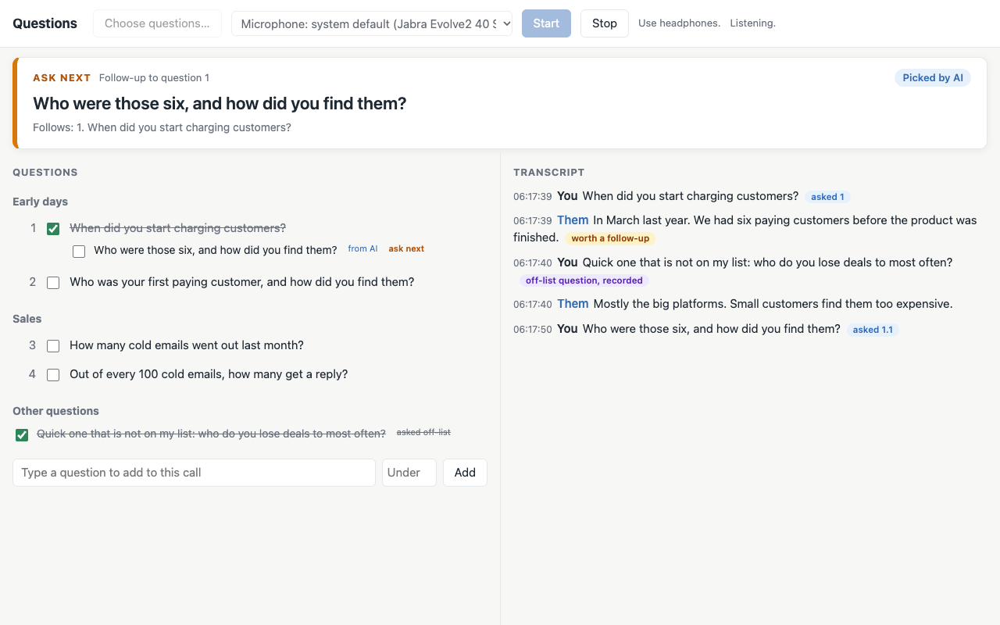

# Call Coach

A live checklist for interviews and discovery calls. Load your questions from a Markdown file, press Start, and Call Coach listens to both sides of the call, transcribes it on your Mac, ticks off each question within seconds of it being answered, and shows you what to ask next. Any AI assistant that speaks MCP can connect to it, run the call, and add follow-up questions while you talk.

## What you see

- **Ask next card** at the top: the one question to ask now, in large type. It follows your list in order. It switches to a follow-up when your AI adds one, and it skips ahead only when the other person is clearly already answering a later question. The label says why: *Next in order*, *Picked by AI*, or *They're already on this*.
- **Questions** on the left. Answered questions are ticked and struck through. Follow-ups sit under the question they came from; questions you ask that were not on your list appear under *Other questions*. The list scrolls to keep your place.
- **Transcript** on the right, always showing the latest line. Your questions are tagged with the list item they matched; answers that invite a follow-up are tagged *worth a follow-up*; questions not on your list are tagged *off-list question, recorded*.
- **Notices** in the corner when something is added for you.
- **Your own additions**: type a question in the box under the list, with an optional question number to make it a follow-up. Tick or untick anything by hand.

## How it works

1. **Capture.** A small Swift helper uses Apple's ScreenCaptureKit to record your microphone and the call's audio as two separate streams, so the transcript knows who said what without guessing: the microphone is **You**, the call is **Them**.
2. **Transcribe.** [whisper.cpp](https://github.com/ggml-org/whisper.cpp) runs on your Mac. Audio is never saved and never leaves your machine.
3. **Score.** [Jev](https://docs.typesafe.ai) by TypeSafe AI is a fast model that answers yes/no and multiple-choice questions about text. Call Coach uses it for three things, each in well under a second:
    - **Ticking.** Has the other person answered each open item? An item is ticked after two confident passes in a row. A question you have not asked yet needs near-certain evidence, so a related answer cannot tick it early.
    - **Following your line.** Which listed question did you just ask, if any? A question that is not on your list is recorded as off-list.
    - **Spotting follow-ups.** Did the other person just say something surprising or revealing? Those answers are flagged, at most one in any three.
4. **Follow up.** Call Coach is an MCP server. Your AI is woken only when an answer is flagged (or after a batch of lines), and adds one short follow-up, which goes straight to the Ask next card.
5. **Save.** Press Stop (or let your AI stop the call) and two Markdown files are written next to your questions file: the transcript, and your list with answered items ticked, follow-ups and off-list questions included. Your questions file is never changed. Saved calls can be read back over MCP.

**What leaves your Mac:** for Jev, the last few minutes of transcript text and your questions; for your AI, whatever its MCP calls return. Never audio. Without a Jev key, Call Coach still transcribes and you tick by hand.

## Requirements

- macOS 15 or later on Apple silicon, with [Homebrew](https://brew.sh)
- Apple's Command Line Tools, to build the audio helper: run `xcode-select --install` once (the installer tells you if they are missing)
- Headphones (see Limitations)
- A Jev API key from [console.typesafe.ai](https://console.typesafe.ai/keys), for automatic ticking
- Optional: an AI assistant that supports MCP over HTTP, for follow-ups

## Install and run

    git clone https://github.com/ByronDarlison/call-coach.git
    cd call-coach
    ./scripts/install.sh

The installer adds whisper.cpp, builds the capture helper, sets up Python, downloads the Whisper model once (about 500 MB), and asks for your Jev key. It saves the key in `~/.config/call-coach/jev-key`, readable only by your account, so you never set it again; press Return to skip and tick by hand. Run the installer again any time to add the key. Call Coach runs only when you start it:

    .venv/bin/call-coach

Open <http://localhost:4800>. In Chrome you can install the page as an app (the install icon in the address bar) so it opens in its own window. Choose your questions file, pick your microphone, put on headphones and press Start. The first time, macOS asks for **Screen Recording** and **Microphone** permission for the app that started Call Coach (usually Terminal); allow both, restart Call Coach, and press Start again.

## Questions file

Any Markdown works. Every list item, numbered or bulleted, is a question; `##` headings group them; a single `#` heading is the title.

    # Founder interview

    ## Early days
    1. When did you start charging customers?
    2. Who was your first paying customer?

    ## Sales
    - How many cold emails went out last month?

## Connect an AI

The MCP endpoint is `http://localhost:4800/mcp` (Streamable HTTP, no login, reachable only from your Mac). Any MCP client running on the same Mac can connect. For Claude Code:

    claude mcp add call-coach --transport http http://localhost:4800/mcp

Then ask it, for example: "Run my interview in Call Coach with ~/interviews/founder.md and add follow-ups." Call Coach tells every connecting AI how to use it efficiently.

| Tool | What it does |
| --- | --- |
| `load_questions_file` | Load a questions file by path, or from Markdown the AI writes |
| `start_call` / `stop_call` | Start and stop listening; stop saves the transcript and results |
| `wait_for_update` | Wait until there is something worth acting on, then return only the new lines |
| `add_question` | Add a follow-up (straight to Ask next) or record a question asked off-list |
| `get_open_questions` | The questions and follow-ups not yet answered |
| `set_next_question` | Override the Ask next card, by key such as `7` or `7.1` |
| `mark_question` | Tick or untick by key |
| `get_session` / `get_transcript` | The full state, or the transcript as Markdown |
| `list_saved_calls` / `read_saved_call` | Find and read past calls, for recaps or preparing the next one |

**Agents with a shell but no MCP** can use the same tools from the command line:

    .venv/bin/call-coach-cli tools
    .venv/bin/call-coach-cli load_questions_file path=~/interviews/founder.md
    .venv/bin/call-coach-cli start_call
    .venv/bin/call-coach-cli wait_for_update cursor=0
    .venv/bin/call-coach-cli add_question text="Who were those six?" under_question=1
    .venv/bin/call-coach-cli stop_call

Each prints JSON. Set `CALL_COACH_URL` to reach a copy on another port.

Cloud-hosted assistants (for example ChatGPT or claude.ai in a browser) cannot reach `localhost`. Do not expose the endpoint through a tunnel: it has no login.

## Cost

- **Jev:** about 1 to 2 US cents for a 45-minute interview. It runs only when someone has said something new; Jev charges about $0.04 per million input tokens, and output is free.
- **Your AI:** depends entirely on the AI and how it is set up. Call Coach keeps it small by waking the AI only for flagged answers and returning only new lines. To keep it smaller still, use a small, fast model, make sure your AI app caches the conversation, and do not load unrelated instruction files into the session that runs the call.

## Configuration

Optional, in `~/.config/call-coach/config.json`:

    {
      "jev": {"api_key_file": "~/.config/call-coach/jev-key"},
      "model": "~/Library/Application Support/call-coach/models/ggml-small.en.bin"
    }

The installer writes this for you. A `TYPESAFE_API_KEY` environment variable, if set, takes priority. To keep the Jev key off your Mac, run a small proxy that holds it, point `jev.url` at the proxy, and set `"broker_secret_file"` to a file containing the proxy's caller secret; Call Coach sends it in an `x-broker-secret` header. `CALL_COACH_PORT` changes the port (default 4800).

## Limitations and plans

- **Headphones are required.** Without them your microphone also hears the other person. Planned: echo filtering so speakers work ([#2](https://github.com/ByronDarlison/call-coach/issues/2)).
- **Mac only.** Windows and Linux need their own audio capture; the helper in `capture/` is the only part to replace.
- **No native app yet.** Planned scope: [#1](https://github.com/ByronDarlison/call-coach/issues/1).

## Development

    .venv/bin/python -m unittest discover -s tests -t .
    .venv/bin/call-coach --dev --questions examples/questions.md

`--dev` enables `POST /api/dev-line` (`{"speaker": "Them", "text": "..."}`) to feed transcript lines without audio, and `POST /api/dev-load` (`{"path": "..."}`) to load a file without the picker.

## Licence

MIT. Whisper and whisper.cpp are MIT-licensed; the model is downloaded from Hugging Face at install time, not shipped here. Jev is a commercial API used under TypeSafe's terms with your own key.
